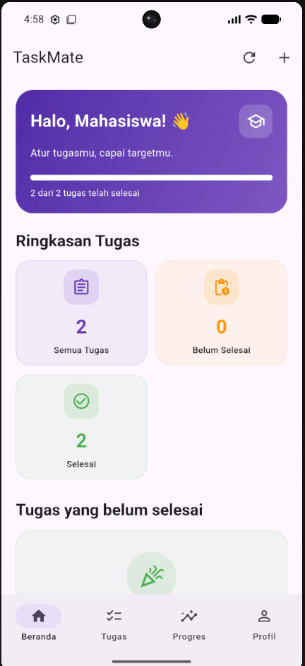
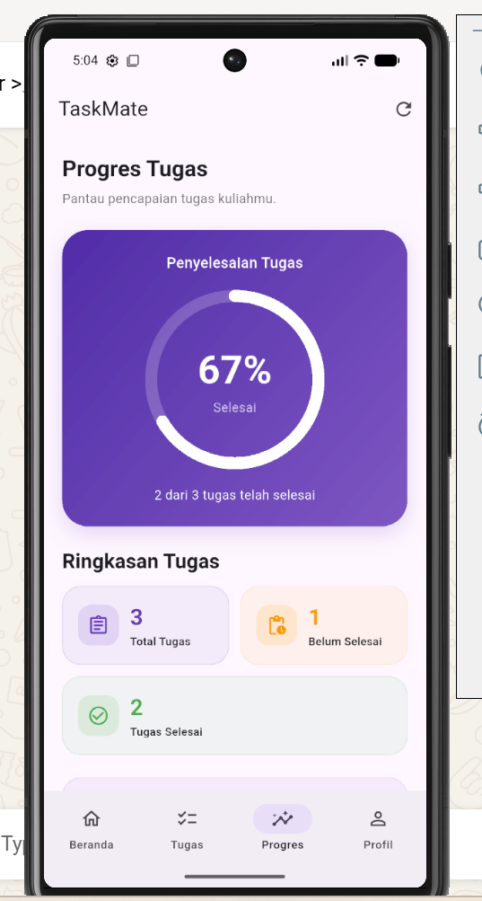
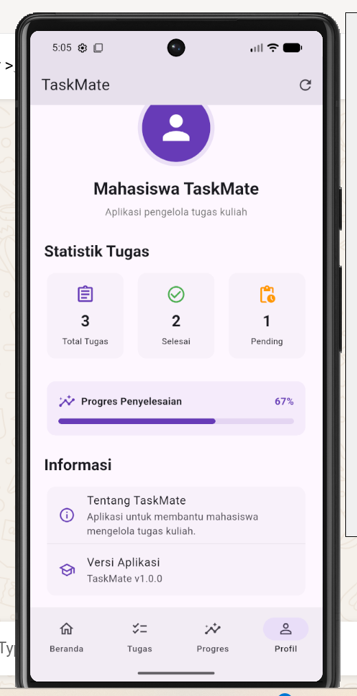

# 📚 TaskMate — Aplikasi Pengelola Tugas Mahasiswa

TaskMate adalah aplikasi mobile berbasis Flutter yang dirancang untuk membantu mahasiswa mengelola tugas kuliah, memantau tenggat waktu, dan melihat progres penyelesaian tugas.

Aplikasi ini dikembangkan sebagai proyek Ujian Tengah Semester (UTS) pada mata kuliah Pemrograman Mobile.

## ✨ Fitur Utama

- **Dashboard:** Menampilkan ringkasan semua tugas, tugas yang belum selesai, dan tugas yang sudah selesai.
- **Manajemen Tugas:** Menambahkan, melihat, mengedit, dan menghapus tugas.
- **Checklist Tugas:** Mengubah status tugas menjadi selesai atau belum selesai.
- **Tanggal Tenggat:** Memilih tanggal tenggat tugas menggunakan date picker.
- **Progres Tugas:** Menampilkan persentase penyelesaian tugas melalui indikator progres.
- **REST API:** Mengambil data dari API dan menampilkan loading, error, empty state, serta fitur retry.
- **Supabase:** Menyimpan dan mengelola data tugas menggunakan operasi CRUD.
- **Validasi Form:** Memastikan kolom wajib diisi sebelum tugas disimpan.
- **Responsive UI:** Menyesuaikan tampilan berdasarkan lebar layar.
- **Feedback Pengguna:** Menampilkan SnackBar untuk memberikan informasi hasil operasi.

## 🛠️ Teknologi

| Teknologi | Keterangan |
|---|---|
| Flutter | Framework untuk membangun aplikasi mobile |
| Dart | Bahasa pemrograman |
| Provider | State management |
| ChangeNotifier | Mengelola perubahan state |
| REST API | Mengambil data dari layanan API |
| Supabase | Backend dan database aplikasi |
| JSON | Format pertukaran data |

## 🏗️ Arsitektur Aplikasi

TaskMate menggunakan pemisahan tanggung jawab agar kode lebih terstruktur, mudah dipelihara, dan dikembangkan.

### Alur REST API

```text
UI / Screen
    ↓
Provider
    ↓
Repository
    ↓
Service
    ↓
REST API
```

### Alur Supabase

```text
UI / Screen
    ↓
Provider
    ↓
Supabase Client
    ↓
Supabase Database
```

Provider menggunakan `ChangeNotifier` untuk mengelola state dan memberi tahu UI ketika data berubah.

## 📱 Screenshot Aplikasi

### 1. Dashboard


### 2. Daftar Tugas


### 3. Detail Tugas


### 4. Tambah Tugas


### 5. Progres


### 6. Profil


## 📂 Struktur Folder

Berikut gambaran struktur folder utama aplikasi TaskMate. Sesuaikan dengan struktur proyek yang sebenarnya.

```text
taskmate/
├── lib/
│   ├── main.dart
│   ├── models/
│   ├── providers/
│   ├── repositories/
│   ├── services/
│   ├── screens/
│   └── widgets/
├── assets/
│   └── screenshots/
├── android/
├── pubspec.yaml
├── pubspec.lock
└── README.md
```

### Penjelasan Folder

| Folder/File | Keterangan |
|---|---|
| `lib/` | Menyimpan kode utama aplikasi Flutter |
| `models/` | Menyimpan model data aplikasi |
| `providers/` | Mengelola state menggunakan Provider dan ChangeNotifier |
| `repositories/` | Mengelola akses data dan komunikasi dengan sumber data |
| `services/` | Menangani komunikasi dengan REST API atau layanan backend |
| `screens/` | Menyimpan halaman atau screen aplikasi |
| `widgets/` | Menyimpan komponen UI yang dapat digunakan kembali |
| `assets/screenshots/` | Menyimpan screenshot aplikasi |
| `pubspec.yaml` | Menyimpan konfigurasi proyek dan dependencies |

## ⚙️ Konfigurasi Supabase

TaskMate menggunakan Supabase sebagai backend untuk menyimpan dan mengelola data tugas mahasiswa.

### Langkah Konfigurasi

1. Buat project baru melalui [Supabase](https://supabase.com/).
2. Buka project Supabase yang telah dibuat.
3. Salin Project URL dan Publishable Key dari pengaturan API project.
4. Masukkan konfigurasi tersebut ke dalam aplikasi TaskMate sesuai dengan konfigurasi pada file `main.dart`.

Contoh konfigurasi:

```dart
await Supabase.initialize(
  url: 'TaskMate Supabase Dashboard](https://supabase.com/dashboard/project/algzhhszwjuiddsvhtoj',
  anonKey: 'sb_publishable_kX3ESXvwpzUP7tukKV1mwA_sSVrnd6u',
);
```

> **Catatan keamanan:** Jangan mengunggah Supabase Secret Key atau Service Role Key ke repository GitHub, terutama pada aplikasi Flutter. Gunakan key yang diperuntukkan bagi aplikasi client dan pastikan Row Level Security (RLS) serta policy database dikonfigurasi dengan benar.

Sesuaikan nama parameter dengan versi package Supabase yang digunakan pada proyek.

## 🚀 Cara Instalasi dan Menjalankan Aplikasi

### Persyaratan

- Flutter SDK
- Dart SDK
- Android Studio atau Visual Studio Code
- Android Emulator atau perangkat Android
- Koneksi internet
- Project Supabase yang telah dikonfigurasi

### Langkah Instalasi

1. Clone repository TaskMate:

   ```bash
   git clone GANTI_DENGAN_URL_REPOSITORY
   ```

2. Masuk ke direktori proyek:

   ```bash
   cd taskmate
   ```

3. Install dependencies:

   ```bash
   flutter pub get
   ```

4. Pastikan konfigurasi Supabase sudah tersedia.

5. Jalankan aplikasi:

   ```bash
   flutter run
   ```

### Memeriksa Konfigurasi Flutter

Untuk memastikan Flutter sudah terpasang dengan benar, jalankan:

```bash
flutter doctor
```

## 📦 Download APK ( https://drive.google.com/file/d/1ZvxDoF1A5H5HSTY9KIdDMoO9inGL1kgm/view?usp=drive_link )
Aplikasi TaskMate dapat diunduh dan dicoba melalui tautan berikut:

[**Download TaskMate APK**](https://drive.google.com/file/d/1ZvxDoF1A5H5HSTY9KIdDMoO9inGL1kgm/view?usp=drive_link)

> Ganti tautan di atas dengan link APK yang sudah diunggah. Jika APK belum tersedia, bagian ini dapat dilengkapi setelah proses build selesai.

## Repository
Repository: (https://github.com/Suwenten814/taskmate)

## 👨‍💻 Identitas Proyek

| Informasi | Keterangan |
|---|---|
| Nama Aplikasi | TaskMate |
| Jenis Proyek | Ujian Tengah Semester (UTS) |
| Mata Kuliah | Pemrograman Mobile |
| Nama Mahasiswa | I Nyoman Suwenten |
| NIM | 2315051033 |
| Kelas | A |
| Platform | Android |
| Framework | Flutter |
| Bahasa Pemrograman | Dart |

---

Dibuat sebagai bagian dari proyek Ujian Tengah Semester.
